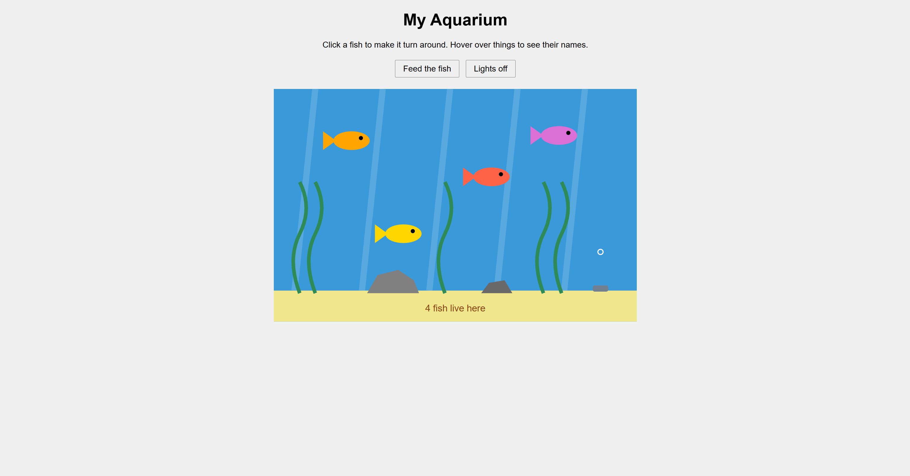

# a1-ghd3

link: https://hert22.github.io/a1-ghd3/

I made an aquarium with d3. There is water, sand, rocks, seaweed, light rays, bubbles and 4 fish.

I used circles for the fish eyes, bubbles and food, rectangles for the water and sand, lines for the light rays, polygons for the rocks and fish tails, and paths for the seaweed.

## Technical Achievements
- used ellipses for the fish bodies and text for the label
- made a function to make the fish so I didnt have to copy it 4 times
- used for loops for the light rays and seaweed
- hover over a fish to see its name
- click a fish to flip it the other way
- bubbles come up from the bottom every second

## Design Achievements
- feed the fish button drops food to the bottom
- lights off button makes the water dark
- each fish is a different color

## Sources
used d3 from d3js.org and got help from Claude (AI)
